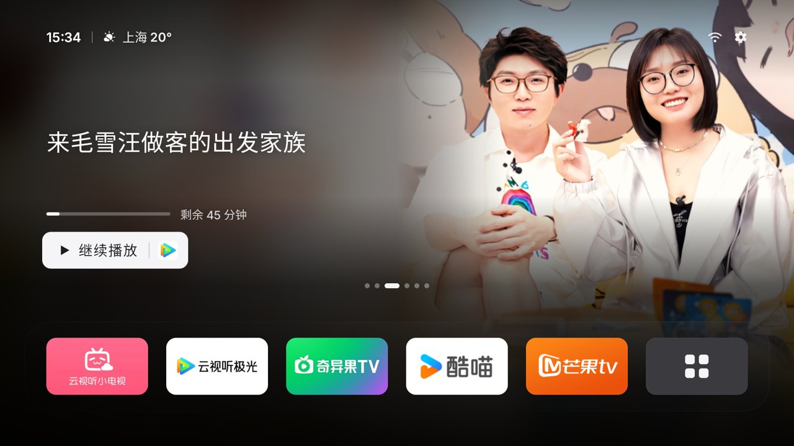
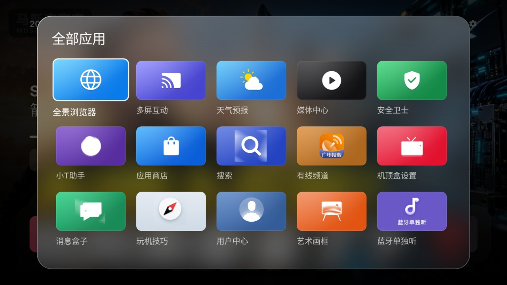
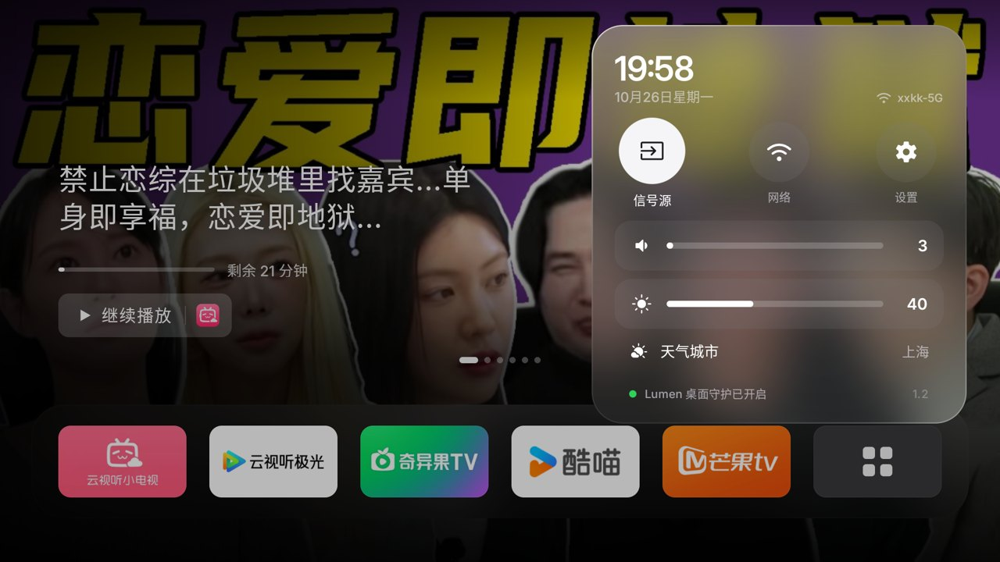

<div align="center">

# Lumen

**给国产电视的 Apple TV 风格桌面。**

打开电视，就是你上次没看完的那一集：全屏封面、一个「继续播放」，下面一排常用 App。<br>
没有广告，没有推荐流。已在 TCL 国行电视上逐项实测。

**中文** · [English](README.en.md)


</div>

## 功能

### 继续播放

- **全屏封面**：首页最上方就是最近在看的内容，封面铺满整屏，左侧只放片名、观看进度和「继续播放」按钮。
- **一键续播**：按「继续播放」直接跳到那一集、那个时间点，不用先进 App 再找。按钮里的小图标告诉你它来自哪个 App。
- **按时间倒序**：最近看的排第一。刚看完回到首页，它就在第一位。看不到 10 秒的、已经看完的，都会自动略过。
- **左右切换**：在「继续播放」上按左右键，翻看最近 6 条记录。
- **竖版海报**：只给竖版海报的平台（比如腾讯视频），海报铺满右半屏，渐隐进背景。

<p align="center">
  
  
</p>

### 应用栏

- 一排 6 个：默认是 **哔哩哔哩、腾讯视频、爱奇艺、优酷、芒果 TV**，最后一个是「全部应用」。
- **长按确定键可以调整顺序**，顺序会记住。
- 你自己装的其他应用会自动接在这五个后面；超过六个时，应用栏会跟着焦点左右滚动。
- TCL 自带的系统应用收在「全部应用」里，不会被卸载或停用。

### 顶栏与控制中心

- 左上：时间和天气，城市名跟随电视的系统语言。默认按网络位置自动定位；国内按 IP 定位常会偏到省会或相邻城市，可以在「控制中心 → 天气城市」里手动选。
- 右上：网络和设置。选中后打开控制中心：信号源、网络、系统设置、音量、亮度。

<p align="center"></p>

### 屏保

- 电视闲置时播放 Apple TV 航拍屏保，代替 TCL 自带的屏保。
- 屏保时按 **Home** 或 **返回** 都能直接回到首页。

## 继续播放支持哪些 App

Lumen 读取的是 **TCL 原厂桌面自己记录的观看历史**（`com.tcl.cyberui` 的历史数据库），各视频 App 播放时会写进去。所以它只在 TCL 国行电视上有效。

| App | 包名 | 记录 | 续播到集和进度 | 封面 |
|---|---|---|---|---|
| 哔哩哔哩（云视听小电视） | `com.xiaodianshi.tv.yst` | ✅ 实测 | ✅ 实测 | 横版 |
| 腾讯视频（云视听极光） | `com.ktcp.csvideo` | ✅ 实测 | ✅ 实测 | 只有竖版海报 |
| 爱奇艺（奇异果 TV） | `com.tcl.qiyiguo` | ✅ 实测 | ✅ 实测 | 横版 |
| 优酷（CIBN 酷喵） | `com.cibn.tv` | ✅ 实测 | ✅ 实测 | 只有竖版海报 |
| 芒果 TV | `com.hunantv.market` | ✅ 实测 | ✅ 实测 | 横版 |

没有观看记录时，首页显示壁纸和应用栏。

## 安装（TCL 国行电视）

需要：一台和电视在同一个 Wi-Fi 下的电脑（macOS 或 Linux），装好 `adb` 和 `python3`。

```bash
brew install android-platform-tools   # macOS；Linux 装 android-tools 或 adb
```

### 第一步：打开电视的 ADB 调试

TCL / 雷鸟的 ADB 开关藏在隐藏菜单里：

1. 用遥控器把电视**音量调到 0**。
2. 进入 **设置 → 关于 → 本机信息**。
3. 在本机信息页面，**快速**依次按方向键 **上、下、左、右**（两次按键间隔不要超过 1 秒）。
4. 页面刷新后会多出「商场」和「更多」两组，在「**更多**」里打开 **ADB** 开关。
   注意：刷新后焦点会停在「商场模式」开关上，**不要直接按确定**，先移开再找 ADB。
5. 在 **设置 → 网络** 里记下电视的 IP 地址，例如 `192.168.1.12`。

> 网上有教程说重启后 ADB 会自动关闭。在 TCL 65V8L 上实测重启后仍保持开启，其他机型如果关了，按上面的步骤再开一次即可。

第一次连接时，电视会弹出「允许 USB 调试吗？」，选**允许**（可以勾选「一律允许」）。

### 第二步：安装并接管首页

```bash
git clone https://github.com/SiaBuilt/lumen-tv.git
cd lumen-tv
TV=192.168.1.12 tools/install.sh guard
```

- TCL 不允许 ADB 直接安装 App。脚本会通过电视自带的「**多屏互动**」把安装包推过去，电视右上角会弹出「正在发起应用推送」，**用遥控器按「右」再按确定，选「同意」**。
- 装好后脚本会自动：授予需要的权限、允许开机自启、开启「Lumen 桌面守护」（让 Home 键回到 Lumen）、把屏保换成航拍。
- 完成后按遥控器的 **Home** 键，就会回到 Lumen。

想用自己编译的版本：`BUILD=1 TV=192.168.1.12 tools/install.sh guard`（需要 JDK 17 和 Android SDK）。

### 更新

Lumen 每隔几小时检查一次新版本。有新版本时，会在电视闲置、进入屏保时通过 TCL 的「多屏互动」在后台自动安装，桌面守护替你点「同意」，不弹任何安装界面。也可以在控制中心里选「更新到 Lumen x」立即更新：

1. 选中它，Lumen 会自己下载新版本（显示下载进度）。
2. 系统安装界面弹出后，Lumen 桌面守护会自动替你点「更新」（TCL 的安装界面不显示按钮选中状态，直接按确定也可以）。

不需要电脑。版本号和安装包同时放在 `lumen.siabuilt.com`（Cloudflare，国内可访问）和 GitHub Releases，优先从前者下载。更新会保留你的应用顺序和设置。

也可以像安装时一样，在电脑上再运行一次：`git pull && TV=192.168.1.12 tools/install.sh guard`。

### 还原

```bash
TV=192.168.1.12 tools/restore.sh              # 交还给 TCL 原厂桌面，保留 Lumen
TV=192.168.1.12 tools/restore.sh --uninstall  # 并卸载 Lumen
```

Lumen 不会卸载、停用任何 TCL 系统应用，还原后电视和原来一样。

### 可选：减少开机广告

TCL 的开机广告由系统组件「开机广告服务」下载，开机动画播放。停用它之后不会再下载新广告，已经缓存的那条过期后就不再播放（缓存文件需要 root 才能删除，所以不会立刻消失）：

```bash
adb -s 192.168.1.12:5555 shell pm disable-user --user 0 com.tcl.bootadservice   # 停用
adb -s 192.168.1.12:5555 shell pm enable com.tcl.bootadservice                  # 恢复
```

### 遇到问题

- **按 Home 回到了 TCL 桌面**：`TV=192.168.1.12 tools/install.sh repair`，会重新拉起桌面守护。
- **多屏互动的提示框没出现**：确认电视没在屏保中（先按一下遥控器），再运行一次安装命令。
- **刚看完的内容没排到第一**：回到首页后等 2～3 秒，有些 App 在退出时才写观看记录。

## 已知限制

- 从哔哩哔哩 App 自己的「历史记录」页打开视频时，哔哩哔哩有时不会把这次观看写进 TCL 的观看历史（或写成别的视频），这时继续播放不会更新。从 Lumen 的「继续播放」打开则正常。

## 其他品牌

- **安装与接管首页**：沿用 Aerial 的适配，小米、TCL 实测过，海信、酷开、乐视有针对性处理（见 [docs/devices](docs/devices)）。非 TCL 电视一般用 `tools/install.sh`（不带 guard）安装。
- **应用栏**：五个视频 App 在不同品牌上的包名不同，小米等品牌常见的版本（云视听极光、银河奇异果、芒果 TV）也会默认排在前面。
- **继续播放**：依赖 TCL 原厂桌面的观看历史，目前只支持 TCL。其他品牌没有可供普通应用读取的观看记录，首页显示壁纸。

## 已验证的电视

| 型号 | 系统 | 安装 | 首页接管 | 开机自启 | 待机唤醒 | 继续播放 |
|---|---|---|---|---|---|---|
| TCL 65V8L（国行，tc8000_ay30a2） | Android 11 | ✅ 多屏互动 | ✅ | ✅ | 未测 | ✅ B站 / 腾讯 / 爱奇艺 / 优酷 / 芒果 |

其他 TCL 国行机型理论上可用（安装和接管方式相同），欢迎反馈。

## 它怎么做到的

- **接管首页**：TCL 只认自己签名的桌面，所以 Lumen 不声明为桌面，而是用一个无障碍服务（「Lumen 桌面守护」）接住 Home 键、并在 TCL 桌面出现时把 Lumen 拉回前台。它不读取任何屏幕内容。
- **继续播放**：读取 TCL 原厂桌面的观看历史数据库（对所有 App 开放读取），按 TCL 桌面自己的方式发出续播指令。不读取各 App 的账号或私有数据。
- **安装**：TCL 的安装校验会拒绝所有 ADB 安装，但接受「多屏互动」推送的 App。协议见 [docs/tcast-protocol.md](docs/tcast-protocol.md)，TCL 的更多细节见 [docs/devices/tcl-mt5879-cn.md](docs/devices/tcl-mt5879-cn.md)。

## 开发

```bash
export JAVA_HOME=/opt/homebrew/opt/openjdk@17
./gradlew assembleGuardRelease
```

发新版本：`app/build.gradle.kts` 里 `versionCode` 加 1 并改 `versionName`，`version.txt` 写新版本号，编译后在 GitHub 发 Release（附 `lumen-guard.apk`），再运行 `tools/publish-update.sh` 同步到 lumen.siabuilt.com。电视会在几小时内（或打开控制中心时）提示更新。

Kotlin + Jetpack Compose，界面按 960×540dp 设计。代码结构见 [docs/ARCHITECTURE.md](docs/ARCHITECTURE.md)。

## 致谢与许可

Lumen 基于 [pengchujin/aerial-tv](https://github.com/pengchujin/aerial-tv)（Aerial）改造：桌面守护、屏保、TCL 安装与自启适配等都来自 Aerial。感谢原作者。

[MIT](LICENSE)。Inter 字体使用 [SIL OFL](FONT-LICENSE-OFL.txt)。App 图标、封面和片名归各自权利人所有。
